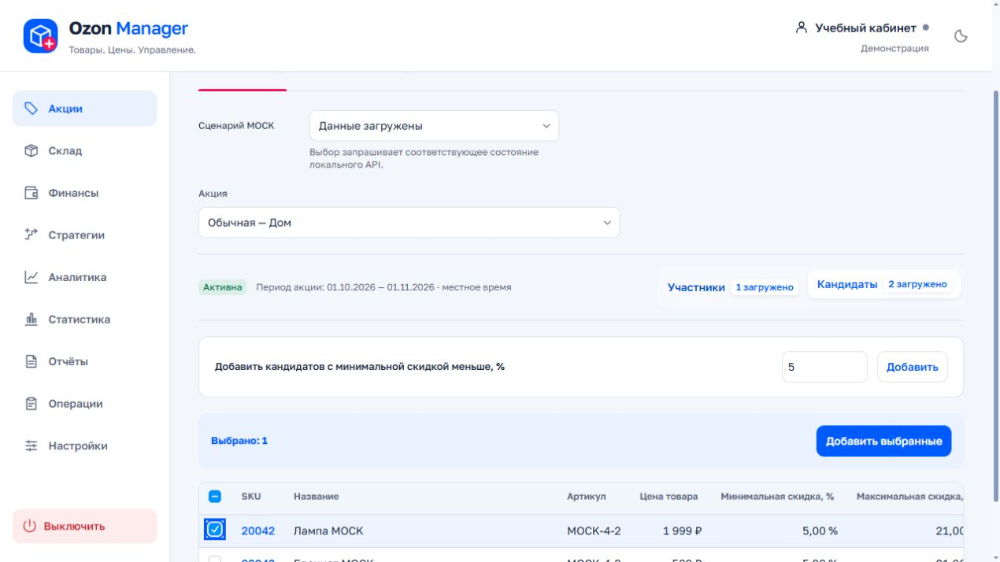
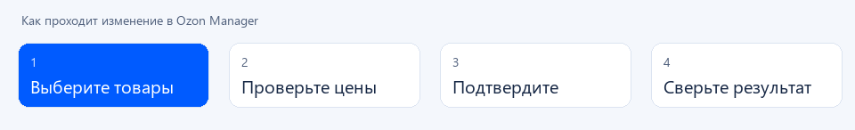

# Ozon Manager

Локальное приложение для работы с товарами и акциями Ozon Seller. Открывается в браузере, работает на вашем компьютере.

## Запуск

1. Скачайте архив и **распакуйте** его в отдельную папку, например `C:\OzonManager`.
2. Дважды нажмите **START.bat**. При первом запуске дождитесь загрузки компонентов и сборки — нужен интернет. Устанавливать Python и Node.js вручную не требуется.
3. Откроется [127.0.0.1:8000](http://127.0.0.1:8000). Если вкладка не появилась, откройте адрес самостоятельно.
4. Добавьте магазин в настройках аккаунтов: название, **Client-Id** и **API-ключ Seller API** из личного кабинета Ozon.

Требуется **Windows 10/11 x64** и доступ к Ozon. Повторный запуск использует уже загруженные компоненты. Для остановки нажмите **STOP.bat**.

## Как работать

| Задача | Действия |
|---|---|
| Добавить в бустинг | **Акции → акция → Кандидаты**. Выделите товары и нажмите «Добавить выбранные». Цена выбирается по минимальной допустимой скидке Ozon. |
| Добавить по порогу | Укажите процент в поле «Добавить кандидатов с минимальной скидкой меньше, %». Например, `5` включает скидки строго меньше 5%. |
| Удалить из акции | **Участники → выделить товары → «Удалить выбранные»**. Удаление по скидке включает товары со скидкой от указанного процента. |
| Вернуть в автодобавление | Выберите акцию и дату в автодобавлении. Возврат использует цену, предложенную Ozon для этой акции и даты. |
| Изменить остатки | Откройте **Склад**, выберите склад и товары, задайте новое доступное количество. |
| Посмотреть финансы | Откройте **Финансы**, выберите период и загрузите данные. Доступность зависит от прав ключа. |
| Проверить результат | Откройте **Операции**: там сохраняются результаты, причины отказов Ozon и сверка. |

Перед изменением проверьте таблицу **«Было / Станет»** и нажмите кнопку подтверждения. При успехе окно закроется автоматически. Если результат не определён, нажмите **«Сверить результат»**, прежде чем создавать новую операцию.

Иллюстрации демонстрационные: реальные товары, магазин и ключи в них не используются.

## Если что-то пошло не так

- **Окно запуска показывает ошибку:** проверьте интернет, сохраните текст ошибки без ключей и повторите START. Не запускайте приложение внутри ZIP.
- **Нет доступа / 401 / 403:** проверьте ключ, Client-Id и права в Ozon Seller.
- **Нет подходящих товаров:** проверьте порог. Для удаления всех используйте выделение строк, без фильтра скидки.
- **Данные неполные:** обновите список и дождитесь загрузки. Не подтверждайте операцию по неполным данным.
- **Порт 8000 занят:** закройте свой прежний экземпляр через STOP; чужие процессы завершать не нужно.

## Данные и ограничения

Подключения и подробная история хранятся локально с шифрованием Windows DPAPI текущего пользователя. Не публикуйте свою рабочую папку: для GitHub используйте чистый исходный архив. Локальные `.env`, `.cache` и `data` в него не входят. Файлы старых `.env`, если вы создавали их самостоятельно, содержат обычный текст.

Рабочая история восстанавливается после перезапуска; её текущий лимит — 16 МБ на раздел. LIVE-черновики недоступны. Рекламные данные требуют отдельного подключения Performance; доступ к отдельному Ozon Statistics API не требуется. Это локальный инструмент, не сервер для общего доступа из интернета.

[Проверки и ограничения выпуска](docs/RELEASE_AUDIT.md) · [Для разработчиков](docs/DEVELOPMENT.md)
